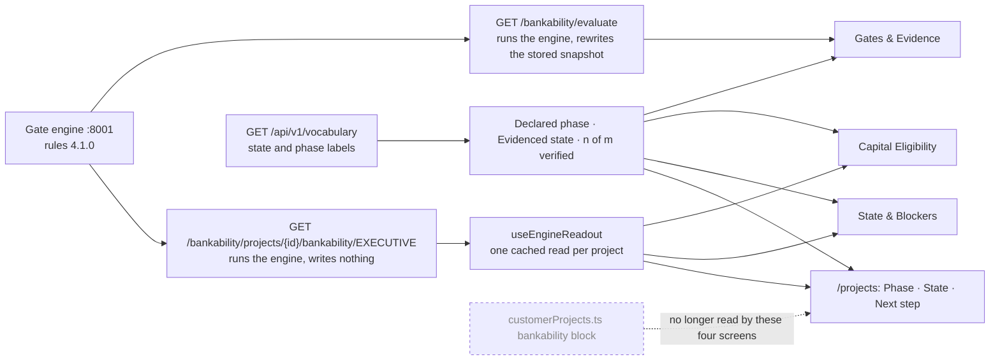

# 06 — Gate screens: what they show, where it comes from, and the proposed fix

Written 30 Sep 2026. Scope: the four screens and the login page reported for the HamburgOne
producer account on project **HamburgOne e-Methanol Plant** (`proj_hamburgone_emethanol`).
Applies D3, D4, D11 and D15(c) (`04_decisions_for_JML.md`). **Status: approved (A–G and T;
"Declared phase"; five molecules; O1 deferred) and implemented 30 Sep 2026 — see §6.**

**Method.** Every figure was traced to its source in code and recomputed by hand. The reported
numbers reproduce exactly: 63.2 → BB, certainty bars 26–31, "effective score 52". The engine's
view is the stored engine snapshot for this project, read in a `READ ONLY` transaction. No
screen was loaded for this inventory, because loading them writes the dev database: signing in
adds `auth_login_history` and `refresh_tokens` rows, and every visit to /stage-gates rewrites
`bankability_snapshots` (`routes_bankability_proxy.py:513`).

## 1. The engine's answer (the reference)

Rules 4.1.0, evaluated 30 Sep 13:44 UTC (the /stage-gates visit that found the problem).

| Item | Engine |
|---|---|
| State | **SPECULATIVE**: "Idea stage — nothing can be committed yet" |
| Phase the engine was told | `development`: grid-connected, project finance. From the code seed `project_registry.py:198`; the project has no `project_context` row |
| Evidence | **0 of 89** applicable items verified (93 in the rules, 4 do not apply to a grid-connected plant). 47 evidence rows are stored, all open requests |
| Gates | All 12 **BLOCKED**: each has unverified deal-killer items. Engine names: G0 Site Rights & Social License … G11 COD & Stabilization |
| Ladders | Offtake **O0**, EPC **E0** |
| Capital | **0 of 8** capital decisions eligible |
| Next | Technically Plausible, waiting on G0 and G1 |

## 2. Root cause

`frontend/src/hooks/useVisibleProjects.ts:89` swaps each seeded project from the server list for
its record in the frontend fixture `customerProjects.ts`. That record includes a hand-written
`bankability` block: gate names, completion, capital amounts and alerts. Nineteen files read
that block. For HamburgOne it says 52 % complete, G0 done, G3 75 %, €8M of grants drawn. Projects
created at runtime get an empty block (0 %) and an empty completion date.

Three other copies of the same project facts disagree with the fixture and with each other:

| Fact | Frontend fixture | Backend `_PROJECT_META` (`routes_projects.py:165`) | Database `projects` row |
|---|---|---|---|
| Capacity | 28 MTPD | 90 MTPD | NULL |
| Target COD | 2028-02-01 | 2027-Q3 | NULL |
| Phase | "FEED / Financial Structuring" | "Structuring" | (no column; context seed says `development`) |
| CAPEX | €185M | €185M | NULL |

The deal-killer inputs are a fourth typed copy: `backend/app/core/project_truth.py:199-211`.

## 3. Inventory by screen

"Agrees" means it matches the engine for the same project.

### /stage-gates — menu "Verification Status" (`StageGatesPage.tsx`)

| Shown | Source | Agrees |
|---|---|---|
| State, next state, state labels, gate names, determinations, x/y verified, O/E levels, capital decisions, lens filter | Engine snapshot (`/bankability/evaluate`) | **Yes** |
| Banner chips "development" and "FEED / Financial Structuring" | Fixture `customerProjects.ts:1888-1889` (`ProjectContextBanner`, `:625-669`) | Partly: the engine was told `development`; the "FEED" text exists only in the fixture |
| Chip on each blocking gate: COST / REVENUE / EXECUTION / CERTIFICATION / COUNTERPARTY | Regular expression on the gate name (`:570-578`) | **No**: the Decomposed Certainty Stack vocabulary, not the engine's (its per-party view is the lens) |
| Related link "Certainty" → /bankability-scores | `:380` | Points at the rating screen |
| "…bankability engine (port 8001) is reachable"; error panel with proxy path and health line | `:2466`, `:2515-2525` | Developer messages |

### /bankability-scores — menu "Status & Blockers" (`BankabilityScorePage.tsx`)

Nothing on this screen comes from the engine.

| Shown | Source | Agrees |
|---|---|---|
| "GEX Quality Rating · v2.1", **indicative rating BB**, score 63.2, D…AAA scale, outlook Stable | `buildFallbackRating` (`:117-207`) over the fixture: √52 × 8.5 = 61.3; +4 for the fixture's "€8M grants drawn"; −2.1 for three alerts; 63.2 → BB | **No**: the engine has no score |
| Rating mechanics: base 61.3, modifiers +1.9, preliminary 63.2, cap | Same | No |
| Peer position "#7 of 12 active projects" | Hard-coded peer list (`:145`) | No: invented peers |
| Strengths "Site Rights Secured — complete", "Technology Vendor Locked (75%)" | Fixture gates (`customerProjects.ts:1921-1961`) | **No**: G0 is 0/4 and blocked. G3 is Feedstock & Logistics Terms, not technology |
| Constraints, including G1 "Power, Water & Critical Utility Access" | Fixture | No: retired G1 name |
| Rating trajectory Nov–Apr, "+x pts", "G0 complete" | `Math.random()` (`:319`) over the fixture | No: redrawn at random on each load |
| Certainty decomposition 31/31/26/29/26, "effective score 52", threshold 0.70 | Five typed constants × fixture completion (`DecomposedCertaintyStack.tsx:208-214`) | No |
| Adjacency card: neighbours, proximity, density, cohort credit, certifier "TÜV SÜD" | `Math.random()` (`AdjacencyCard.tsx:139`); certifier hard-coded (`:146`; the fixture says DNV) | No |
| Score Impact Simulator: +6.6 complete G1; +5 verify 18 items; **+5 "Advance to construction phase"**; +2.1 resolve alerts | `buildImpactLevers` (`:211-306`) | No: it rewards editing a status field |
| Bank Assessment: bank letter against GEX letter, "notches" narrative | Browser `localStorage` (`:937-958`) | No: outside the system of record (D3) |
| Action Plan "BLOCKED". FATAL: binding offtake < 50 %, no EPC, no audited model, third-party offtake < 30 %. CRITICAL: insurance not bound, no firm grid offer. "+N pts if resolved" | Backend `deal_killers.py:58-215` over the typed dict `project_truth.py:202-211`; points from fixture completion | **No**: these thresholds match no engine rule. The engine asks for O2 terms on ≥ 60 % of output at Commercially Plausible and O4 at G4. G7 tests insurability; binding happens at G10. The typed input `ie_appointed: True` contradicts 0 verified |
| Verification gaps G5 / G6 / G7 ("Bind CAR/EAR and DSU insurance lines") | Hard-coded `DEMO_ATTENTION` (`:512-528`) | No. It also contradicts the deal-killer dict, which says an IE is appointed |
| Advanced: raw and effective gate scores, AUD/CONF/SUB/UNVER counts | Hard-coded `DEMO_GATE_SCORES` (`:497-510`), identical for every project | No: "state machine uses effective scores" is false |
| Header phase "FEED / Financial Structuring" | Fixture | The engine was told `development` |
| Export Report (copies "Rating: BB (63.2)" to the clipboard) | `:432-493` | Carries the letter rating off the screen |
| "Re-evaluate" button | No handler (`:614-617`) | Does nothing |

### /projects — menu "Current Projects" (`ProjectsPage.tsx`)

| Shown | Source | Agrees |
|---|---|---|
| **BNK 52 %** | Fixture `overall_completion` | **No**: 0 of 89 |
| E·G·C·B bar: E 36 %, G 20 %, C 4 %, B 0 % | Fixture gates, capital and alerts (`bankabilityAxes`, `:121-150`) | No |
| Stat **DEV** | Fixture status (seeded) or database status (runtime) | The claim, shown without the evidenced state |
| Row dot "needs action" / "behind", header counts, state filter | Fixture: completion < 50 plus alerts (`:154-164`) | No engine concept; typed threshold |
| "Your next action", e.g. "Escalate: bankability 52 % — below threshold" or "Advance Strategic Equity to credit approval" | Fixture (`:238-309`) | No |
| Cpx/Opx% **4 %** | Fixture capital: €8M "drawn" ÷ €185M (`:92-101`) | **No**: 0 of 8 decisions eligible, and GEX records no drawn capital |
| COD "FEB-28" for HamburgOne | Fixture 2028-02-01 (backend 2027-Q3, database NULL) | A declared field with three sources |
| COD **INVALID DATE-aN** for North Sea e-Methanol and Wilhelmshaven e-Ammonia | Database `completion_date` NULL → `''` → `new Date('')` (`fmtCod`, `:422-427`) | Formatting bug |
| Expanded row: open blockers ("G1 ppa register +8", "blocks €30M NordLB LC / DFI · €102M Senior Debt") | Fixture | No |
| Expanded row: capital stack (€8M drawn, €45M and €30M indicative, €102M no engagement) | Fixture | No |
| Expanded row: Phase "FEED / Financial Structuring", Status DEV, "CAPEX fin. 4 %" | Fixture | See above |
| Expanded row: capacity derivation (365 days, 80 % to tokenise, typed prices) | Fixture and constants | Not a gate, state, score or capital figure; out of scope (handoff items 21, 27) |
| Risk flags | Backend risk-flag registry (`useRiskFlags`) | Not a gate, state, score or capital figure; left alone |

### /finance/bankability — menu "Project Readiness" (`FinanceBankabilityView.tsx`)

| Shown | Source | Agrees |
|---|---|---|
| Finance-view gates (G4, G6, G7, G8, G10): engine names, x/y, % | Engine (persona route, `:324`; this route does not write) | **Yes** |
| "Gates Complete **0 %**" | Engine `overall_completion_pct` | The value is right, the label wrong: it counts evidence items, not gates |
| "Capital Unlocked **0 / 8**" | Engine `decision_eligible` | The value is right, the label wrong: the engine says "no screen should call the result unlocked" (`bankability_engine.py:1879-1881`) |
| Capital rows: "Unlocked", "Locked by …", "n % remaining", amount "N/A", static texts "Unlocks on…", "Disburses on…", "Releases on…" | Engine plus frontend wording (`:58-67`, `:478-557`) | Wording no. The static reasons also map gates to capital differently from the engine (D15(a)) |
| Next milestone "Complete G0_SITE_RIGHTS, G1_GRID_UTILITIES_REALITY → TECHNICALLY_PLAUSIBLE" | Engine identifiers (`:356-358`) | The value is right, but shown as raw identifiers |
| State strip "identified … closed", verification "UNVERIFIED" | Package states derived from the fixture status and % thresholds (`:167-177`, `:419-428`) | **No**: a third state vocabulary |
| Capital eligibility bar: €8M grants drawn, €45M, €30M NordLB, €102M | Fixture (`:429-436`) | **No**: it contradicts "0 / 8" two cards below |
| Pre-COD metrics CEC, FRI, RMR, CBM, LLCR, S&U; "FID READY / NOT READY" | Client-side proxies over engine gate data | Not engine. D11 keeps them out of client material |
| "⚠ proxy mode (start backend for the governed model)", "PROXY MODE" | `:1461`, `:1570` | A developer message, and false: the backend is up. The route returns 404 because the project has **0 development packages** (`pre_cod_metrics.py:692-697`) |
| Fallback when the engine does not answer | Fixture (`buildFallback`, `:250-281`) | Would show fixture gates as if the engine produced them |

When the pre-COD route does answer, the panel posts `save_snapshot: true`, so viewing the page
writes `pre_cod_snapshots` (`:1509-1518`).

### Login (`LoginPage.tsx:339-349`)

| Shown | Agrees |
|---|---|
| 12 Bankability Gates | Yes |
| 9 Lifecycle States | Yes (Refinancing Eligible is in the order but not yet computed, N22) |
| **4 Fuel Molecules** beside a sentence naming five (H₂, NH₃, e-NG, HVO, e-MeOH) | Contradicts itself. `fuel_catalog` holds 10; the TEA engine costs 3 |

### Checked, and not on these screens

- `gex_project_rating_engine.py` is served at `POST /api/v1/project-ratings/score` and takes typed
  pillar scores and notches. Its only UI, `ProjectRatingView.tsx`, is imported nowhere. The BB on
  /bankability-scores imitates it in the browser; it never calls it.
- `contractual_rating_engine.py` feeds `open_interest` (`CREDIT_ORDINAL`); the tenor score at
  `:227` is D15(b).
- `useGateAccess.ts:24,60` locks menu screens using the fixture's gate % against a 60 % threshold
  that is not an engine rule.
- `vocabulary.py` "readiness" describes the nine states in pre-4.0.0 words (for example,
  CREDIT_APPROVED: "A lender's credit process has approved the project"). No screen reads
  `/api/v1/vocabulary`.

## 4. Proposed change set (frontend only; no backend or database change)

Every gate, state and capital figure on these screens then comes from one engine snapshot, with
the engine's names. Nothing falls back to the fixture: if the engine does not answer, the screen
says so.

**A. Shared**
- **A1** `hooks/useEngineReadout.ts` (new, ~40 lines): one cached read of
  `GET /api/v1/bankability/projects/{id}/bankability/EXECUTIVE`. This route runs the engine and
  writes nothing.
- **A2** `components/ClaimedVsEvidenced.tsx` (new, ~60 lines): one line from the snapshot.
  > Declared phase **Development** · Evidenced state **Speculative** · Idea stage — nothing can be
  > committed yet · 0 of 89 applicable evidence items verified

  The phase is the one the engine was told (`project_phase`, from project context), or "not
  recorded". Display names come from `/api/v1/vocabulary`, the platform's one label source.

**B. /bankability-scores** (body replaced; about 1,250 lines → about 200)
- Removed: the rating card, letter scale, score, peers and mechanics; the trajectory; the Score
  Impact Simulator; the certainty decomposition; the adjacency card; the bank-rating comparison;
  the deal-killer action plan and its "+N pts"; the hard-coded attention items and gate-score
  table; Export Report; the dead Re-evaluate button; the NH3/SAF fixture gating alert.
- Shown instead, all from A1: the A2 line; "what blocks the next state" (engine gate names,
  determinations, x/y, the engine's own deal-killer items by label, commitment shortfalls);
  offtake and EPC levels with the engine's reasons; capital decisions eligible, "0 of 8", with the
  engine's sentence "GEX does not commit, release or draw capital"; a link to act in Gates &
  Evidence.

**C. /finance/bankability**
- **C1** Remove the fixture fallback; show an honest empty state instead.
- **C2** Remove the state strip and the capital eligibility bar (fixture amounts).
- **C3** Relabel the cards from engine fields: "Gates satisfied 0 of 12", "Evidence verified 0 of
  89", "Eligible for a capital decision 0 of 8".
- **C4** Capital rows: "Eligible" or "Waiting on ⟨engine gate name⟩". Drop "Unlocked", "% remaining",
  "N/A" and the static reason texts. This also settles D15(a) on this screen.
- **C5** Next milestone in engine names ("Technically Plausible — waiting on G0 Site Rights &
  Social License, G1 Power, Utilities & Technology Basis").
- **C6** Remove the pre-COD panel and its code from this view (D11). This removes "proxy mode" and
  the write on page view. The backend route is untouched.
- **C7** The A2 line.

**D. /projects**
- **D1** "Bnk · E·G·C·B" → **State**: the engine state, with "0/89" beneath (A1, one read per row).
  Replace the legend.
- **D2** "Stat" → **Phase** (declared). Each row then reads Phase | State: the claimed phase
  against the evidenced state.
- **D3** COD: "—" when empty; a non-date such as "2027-Q3" is shown as entered.
- **D4** Remove the Cpx/Opx% column and, in the expanded row, "CAPEX fin." and the capital stack
  (fixture money).
- **D5** Remove the state dot, its counts and its filter (typed threshold on the fixture).
- **D6** "Your next action" text and "Open blockers" from the engine (next state, blocking gates by
  name, the capital decision each gate gates, no €). The role-based routing stays as it is.
- **D7** Expanded row: Phase from the engine, add State, drop the "Status" chip. Rename the
  "Bankability" fallback labels to the screen's new name.

**E. /stage-gates**
- **E1** The banner shows the A2 line (from its own snapshot) instead of the fixture chips.
- **E2** Remove the certainty chip; the lens filter already gives the per-party view (D4).
- **E3** Related links carry the new names.
- **E4** Replace the port-8001 and proxy-health texts with "The change was not saved: ⟨server
  reason⟩" and a Retry.

**F. One name per concept** (menu labels, page titles, links; URLs unchanged)
- /stage-gates "Verification Status" / "Bankability Stage Gates" → **Gates & Evidence**
- /bankability-scores "Status & Blockers" / "Bankability Status" → **State & Blockers**
- /finance/bankability "Project Readiness" / "Finance bankability" → **Capital Eligibility**
- In text: "unlocked" → "eligible for a capital decision"; "BNK / completion / effective score" →
  "evidence verified"; "status / stage" → "phase" (declared) or "state" (evidenced).

**G. Login**: one list renders both the sentence and the count, so they cannot disagree. Also fixes
"e-NG ,HVO".

**T. Tests** (vitest, mocked responses, no database)
- **T1** A2 renders the phase, state and count, and "not recorded" when the phase is missing.
- **T2** /bankability-scores: no letter grade or score, engine gate names only, and an empty state
  (not the fixture) when the engine fails.
- **T3** /finance/bankability: the new labels, no "Unlocked", no "proxy mode", no request to
  `/pre-cod-metrics`, and an empty state when the engine fails.
- **T4** /projects: "—" for an empty COD, State from the engine, no "BNK".
- **T5** A source guard: the four screen files contain no fixture `.bankability.` reads, no
  `Math.random`, no "proxy mode" and no "port 8001". Negative-verified by reintroducing each.
- **T6** Login: the count equals the length of the list.
- Then `npm test` (baseline 189 pass, 1 known failure in `EconomicsSnapshotPage`) and `npm run
  build` (menu, causal-ways and Supabase gates, then `tsc` and Vite).

**Optional O1.** Delete the rating code nothing renders afterwards: `GexProjectRatingCard`,
`ProjectRatingView`, `useProjectRating`, `lib/api/projectRatings`, `types/projectRating`.

## 5. Not in this change (follow-ups)

1. The root, D15(c) proper. `useVisibleProjects.ts:89` still gives seeded projects the fixture
   block. Fifteen other files read it, and `useGateAccess` locks screens on it. Retiring it changes
   which screens unlock.
2. `deal_killers.py` with `project_truth.py` still feeds TaskRouter, Evidence Hierarchy and the IC
   pack export check. Retire it, or derive it from the engine's own deal-killer items.
3. `routes_project_ratings` accepts typed scores (D4: internal scores are derived, never typed).
4. The three copies of project facts in §2.
5. The vocabulary's state descriptions predate 4.0.0.
6. Views that write: /stage-gates (`/evaluate`), and the pre-COD panel wherever it remains.
7. /producer-bankability is labelled "Construction Progress" in the menu but "Gate Evidence" in
   /projects links.
8. Found while implementing: the two HamburgOne projects created at runtime have **no project
   context** (lost in the 28 Sep reset, handoff item 38), so the engine evaluates them with no
   phase, power model or financing model: 93 items instead of 89, and "Declared phase — not
   recorded". The owner can re-declare them; nothing was entered on their behalf.
9. Gates & Evidence keeps its own title-case state labels ("Technically Plausible"); the new line
   uses the vocabulary's ("Technically plausible"). Same words, different case; switching that
   page to the vocabulary is a one-line follow-up.

## 6. What was implemented (30 Sep 2026)

Where the figures on the four screens come from now:

**Files.** New: `frontend/src/lib/engineReadout.ts`, `frontend/src/hooks/useEngineReadout.ts`,
`frontend/src/components/DeclaredVsEvidenced.tsx`. Rewritten: `BankabilityScorePage.tsx` (State &
Blockers, 1,253 → 204 lines), `FinanceBankabilityView.tsx` (Capital Eligibility, 1,679 → 376; the
pre-COD panel went with it), `ProjectsPage.tsx` (1,080 → 763). Edited: `StageGatesPage.tsx`,
`config/menuArchitecture.ts`, `features/auth/LoginPage.tsx`, `api.ts` (`bankabilityAPI.readout`,
`vocabularyAPI`, and the HTTP status on every thrown error).

**One addition beyond the list, for the same reason as E4.** When the engine is down the backend
answers "Bankability engine unavailable (port 8001)", and screens printed it. `fetchAPI` now
attaches the HTTP status, and the gate screens show a refusal's reason (4xx) but, for an outage
(5xx), only "The gate engine did not answer".

**Also changed.** `npm run build` was **already failing** before this work: the generated menu
map `docs/menu-architecture-map.md` (§9, §10) was stale. Regenerated with `npm run audit:menu`;
two of its door↔screen mismatches ("Status & Blockers", "Verification Status") are gone because
of the renames. Its Sources & Uses row then read "NAKED" because the pattern `/suc/i` matched
"onSuccess"; tightened to `\bsuc\b` in `scripts/audit-menu.mjs`, and the row now reads
"engine-only", which is true.

**Tests (vitest, mocked responses, no database).** 22 new, in 6 files: T1
`components/__tests__/DeclaredVsEvidenced.test.tsx` (3), T2
`features/finance/__tests__/BankabilityScorePage.test.tsx` (5), T3
`features/finance/__tests__/FinanceBankabilityView.test.tsx` (4), T4
`features/projects/__tests__/ProjectsPage.test.tsx` (4), T5 `__tests__/gateScreensSource.test.ts` (5),
T6 `features/auth/__tests__/LoginPage.test.tsx` (1). T2–T4 render the **real** fixture record for
HamburgOne and assert none of its figures appear. Ten deliberate breaks, each reintroducing one
defect (letter rating, fixture fallback, "Capital Unlocked", a pre-COD POST on view, the old COD
formatter, the BNK label, a dropped declared phase, a typed molecule count, a port message,
`Math.random`), were **all caught**, and every file was restored byte for byte.

**Results.** `npm test`: 211 pass, 1 fail. The failure is the known pre-existing one in
`EconomicsSnapshotPage.test.tsx`, and the arithmetic closes: the baseline was 189 pass + 1 fail of
190, plus 22 new. `npm run build`: menu, causal-ways and Supabase gates pass, then `tsc` and Vite
build (exit 0). No backend file changed.

**Checked in the browser** (localhost, signed in as the HamburgOne producer with the seed demo
account, as the owner allowed). Every screen read as the engine does: Speculative, 0 of 89, O0/E0,
0 of 8, engine gate names. The login page shows "5 Fuel Molecules". The network log for Capital
Eligibility holds only reads, and no request to `/pre-cod-metrics`. No console errors. The check
wrote what the owner allowed: a sign-in (`auth_login_history`, `refresh_tokens`) and one rewrite of
this project's row in `bankability_snapshots` by opening Gates & Evidence.

**Not verified.** vexp's `verify_done` could not run (no daemon registered for this directory);
the whole-project `tsc`, the full suite and the build cover its checks.
