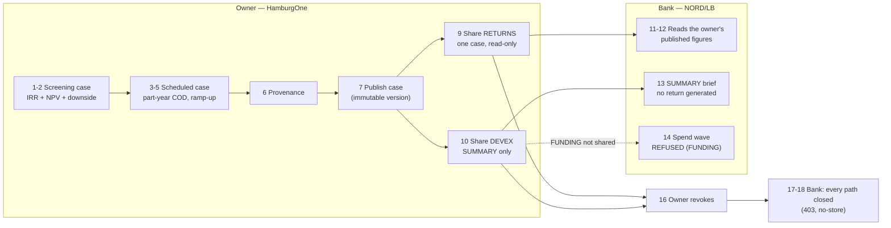

# Handoff v4 — screenshots, 17 Nov 2026

Owner: Lisa Friedrich (HamburgOne, Executive). Bank: Henrik Vost (NORD/LB). Projects:
North Sea e-Methanol (owner steps 1–10) and HamburgOne e-Methanol (bank steps 11–18 — the bank
can select only that project; see finding A). **All inputs are ILLUSTRATIVE.** Numbers in red
point at the element each legend line explains. Regenerate with
`backend/venv/bin/python docs/screenshots/handoff_v4/annotate.py` (raw captures in `raw/`).

| Step | Image | What it shows |
|---|---|---|
| — | [01](01_owner_returns_start.png) | Owner opens Returns; illustrative inputs |
| 1 | [02](02_screening_case.png) | Screening case: IRR with NPV; DSCR "no approved threshold" (GEX proposed 1.25x not in force) |
| 2 | [03](03_screening_downside.png) | Ten downside sensitivities |
| 3 | [04](04_scheduled_inputs.png) | Scheduled case: COD 30 months (part year), ramp-up 60 % / 85 % |
| 4 | [05](05_screening_vs_scheduled.png) | Both methods and both cash-flow timelines |
| 5 | [06](06_scheduled_debt_and_downside.png) | DSCR min 0.68x shown, not judged |
| 6 | [07](07_provenance.png) | Provenance: model, TEA case, checks, validity |
| 7 | [08](08_published_cases.png) | Published cases (FULL_PROJECT and FROM_FID) with identity |
| 8 | [09](09_audience_suggestions.png) | Audience suggestions, PROPOSED, grant nothing |
| 9 | [10](10_share_returns_case.png) | Owner shares one case with the bank |
| 10 | [11](11_share_devex_summary.png) | Owner shares DEVEX SUMMARY only |
| 11 | [12](12_bank_sees_shared_case.png) | Bank sees the shared case; calculator labelled its own |
| 12 | [13](13_bank_reads_owner_case.png) | Bank reads the owner's figures; withheld items stated |
| 13 | [14](14_bank_devex_summary.png) | Bank's brief: SUMMARY only |
| 14 | [15](15_bank_spend_wave_refused.png) | Spend wave refused (FUNDING not shared) |
| 15 | [16](16_bank_package_register.png) | Register (finding B) |
| 16 | [17](17_owner_revokes.png) | Owner revokes |
| 17 | [18](18_bank_after_revoke_returns.png) | Bank: Returns closed |
| 18 | [19](19_bank_after_revoke_brief.png) | Bank: brief closed |
| — | [20](20_gap_analysis_not_recorded.png) | Gap Analysis on a project with no inputs of its own |
| — | [21](21_finding_brief_screen_role.png) | Finding C |

**Not shown:** Gap Analysis with requirement-level gaps and the conditional outcome. Only Le
Havre and Wales hold structuring inputs, neither has an owner account, and no GEX staff
account is in the demo list. "Needs review" after an evidence change was not triggered: it
would need an evidence write on a client project (covered by `test_returns_cases.py`).

**18 Nov — JML decided all four** (handoff §8 item 93): A shared projects now appear in the
bank's list, showing only what was shared (a participation record is still to be designed); B the
write controls show for the owner only; C one "DEVEX Brief" page; D seeding is off by default and
never overwrites an existing account. Correction: two North Sea shares from screens 10–11 had
stayed active; they were revoked on 18 Nov.

**Findings for JML (17 Nov, as raised)**
- **A. A share does not make a project selectable.** Visibility comes from roles in the token;
  a bank holding only a share on North Sea cannot pick it in the app (its paths answer via the
  API). Showing shared projects in the list would disclose their name and profile: a decision.
- **B. The package register offers "New package" to a bank.** The server refuses the write;
  the buttons should be hidden for non-owners.
- **C. The owner's DEVEX brief screen is role-gated for banks;** a bank reads its share on
  "Shared DEVEX Brief" instead (step 13). Consistent, but two screens for one brief.
- **D. Every backend start resets the demo accounts' passwords** to the seed value
  (`app/core/auth.py` `_seed_user`, `ON CONFLICT … password_hash=excluded.password_hash`). A
  password changed on a demo account does not survive a restart — and a restart today reset
  one that had been changed. Already on the production checklist (login page lists the demo
  password).
